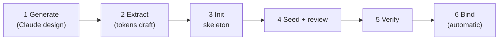

# Intent Engineering SDLC — Seeding the Design System

> How to give this hub a **design system** — the single source for the colours, type, spacing and other *design tokens* that every UI spec and every generated frontend binds to. Do this **once, before shaping UI features**; after that it governs automatically. Shipped and kept fresh by `ie update` — read it, don't edit it.
>
> New to the vocabulary (*token*, *primitive*, *semantic*, `_base`)? → [`GLOSSARY.md`](GLOSSARY.md). The full operator map → [`WORKFLOW.md`](WORKFLOW.md).

There is **no automatic importer**. You generate a design with Claude, Claude extracts candidate tokens from it, and *you review them* before they become canonical — extraction proposes, the hub is the source of truth only after you accept. The CLI handles the scaffolding, checking and compiling; Claude does the extraction and authoring.

## The flow



**Before you start:** the hub is initialised (`ie init` done) and your target app is declared in `config.yml` (the `apps:` block). If you have a single app, you can pass `--app <id>` to every command below instead.

---

### 1. Generate the visual language

Produce a coherent design with Claude — palette, type, spacing, and a few real components to anchor the values.

> **Say to Claude:** *"Design a dense B2B platform UI for the `<app>` app — neutral grays, one blue accent, system font, a 4px spacing scale. Show buttons, inputs, a card, and a data table."*

(Other valid sources, all converging on the same next step: Figma Make, a Claude artifact, or a v0.dev-style export)

### 2. Extract candidate tokens

Ask Claude to read that design and turn it into a **draft** in the design-system YAML shape — *don't write files yet*.

> **Say to Claude:** *"Read the design you just produced and extract design tokens into a `tokens.yml` draft with two sections: `primitives` (the raw colour / font / scale values) and `semantic` (names like `color-primary` and `spacing-md` mapped to those primitives). Cluster near-duplicate colours, snap spacing to the 4px scale, dedupe. Give me the draft plus a short consolidation report — no files yet."*

### 3. Init the skeleton

Scaffold the neutral (brand-free) token files the draft will fill.

> **Say to Claude:** *"Run `ie design-system init --app <app>`."*
> **Runs:** `ie design-system init --app <app>`
> Creates `design-system/_base/tokens.yml` (shared brand core) and `design-system/<app>/tokens.yml` (this app's theme).

### 4. Seed + review (your gate)

Write the reviewed draft into the skeleton. **Primitives live only in `_base`** — an app theme may add or override *semantic* tokens, never primitives (the brand must not fork; `ie design-system check` rejects a `primitives:` block in an app layer).

> **Say to Claude:** *"Write the primitives and shared semantic tokens into `design-system/_base/tokens.yml`, and any `<app>`-specific semantic overrides into `design-system/<app>/tokens.yml`. Show me the diff before writing."*

Review the diff, then accept. Nothing is canonical until you do.

### 5. Verify

Confirm the vocabulary resolves and nothing dangles.

> **Say to Claude:** *"Run `ie design-system tokens --app <app>` so I can eyeball the resolved vocabulary, then `ie design-system check --app <app>` and fix anything it flags."*
> **Runs:** `ie design-system tokens --app <app>` · `ie design-system check --app <app>`
> `tokens` lists what authors may reference; `check` fails on a typo'd or invented token (`color-prinary`) or a hardcoded value — and names the nearest match.

### 6. Bind — automatic from here

Once the design system exists, the rest of the SDLC binds to it with no extra steps:

- **`/ie/shape-screen`** surfaces the token vocabulary to the author and checks every reference.
- **Phase-2 integrity** (Iron Dome) **blocks** a screen that references a token which doesn't exist.
- **`/ie/generate`** compiles the tokens to CSS custom properties (`ie design-system compile`) and binds component-tree tokens to `var(--token)` — never hardcoded.

---

## After seeding: don't re-import

Ingestion is **seed-time only**. When a later UI feature needs a colour or token the system doesn't have, add it **upstream** through the feature's normal approval gate (`shaping → specified → approved`) — extend `tokens.yml`, don't inline a raw value, and don't run another bulk extract. A second import would fight the canonical source and reopen drift (fix upstream).

*(This rule is for the hand-authored flow above. If this hub binds to a vendor's own design system instead, re-pulling the vendor's catalog — `ie design-system vendor refresh` — is expected and tracked; see below.)*

## Command reference

| Command | What it does |
|---------|--------------|
| `ie design-system init --app <app>` | Scaffold `_base` + per-app token skeletons (neutral, no brand) |
| `ie design-system tokens --app <app>` | List the resolved token vocabulary (`app ∪ _base`) — for authoring |
| `ie design-system check --app <app>` | Verify every screen's token references resolve; fail on dangling / hardcoded |
| `ie design-system compile --app <app> --out <file.css>` | Resolve tokens to CSS custom properties (used at generate-time) |
| `ie design-system render --app <app>` | Emit a browsable, offline HTML view of this app's tokens + components (inventory ∪ vendor lock) |
| `ie design-system set-impl --app <app> --component <type> --kind custom \| dependency` | Record how one component is realized — the package to install, the module to copy, the `--pattern` standard that says how to produce it, and the `--contract` standard that says how it must behave |

Run `ie design-system --help` for full options. Every command supports `--json`.

---

## Browse the design system

Reading YAML is a poor way to *see* a design system. `render` emits a single, self-contained HTML page — colours as swatches, spacing/type/radii at true size, and every component with its provenance, realization (`impl`), behaviour contract, variants, vendor version and, for a vendor-bound layer, its recorded prop contract — from the files the hub already committed.

> **Say to Claude:** *"Run `ie design-system render --app <app>`."* — then open the file it prints (it writes to a temp path by default; pass `--out <file.html>` to choose where).

It's a **view, never a source of truth** — derived, read-only, offline (no live vendor MCP call), and never a gate. Iron Dome keeps validating the committed files alone. Regenerate it any time; it's ephemeral, not committed.

**What it honestly shows — and what it doesn't.** Tokens render *faithfully*: a swatch painted `#1D4ED8` **is** `color-primary`, resolved through `app ∪ _base` (app overrides are badged). Components render as **governed facts plus a labelled schematic placeholder** — deliberately *not* a pixel-accurate preview. On a vendor-bound layer the Layer filter gains a **Vendor lock** pill for components that resolve from the vendor's catalog alone, and each such card carries the vendor's prop table (types, defaults, and the enums a value must come from). A component the lock records no contract for shows no table — absent is reported as absent, never as "no props". A real component render needs the framework runtime and the component's real code (which lives in the service repo, not the hub), so the explorer shows what's true offline and stamps the placeholder *"schematic — not the rendered component"* rather than fake a button you might mistake for the real thing. For a pixel-accurate preview, use the frontend build in the service repo.

---

## Alternative: binding to an existing vendor design system (opt-in)

> Everything above is for a hub that **hand-authors** its own design system. If a client engagement already has its own component/token library (their own design system, exposed as an MCP server), bind to it instead — additive to everything above, never a replacement. A hub that never touches this section keeps working exactly as described above.

**When to use this:** the hub should draw its tokens/components from an external, versioned library rather than hand-authoring them from scratch — typically a client's existing design system.

### 0. Make the vendor's MCP server reachable

The vendor's design system is exposed as an **MCP server** your coding agent talks to — `ie-cli` never opens a socket or speaks MCP itself (that stays the agent's job, same as any other MCP tool use). The server entry lives in your agent's **machine-local** MCP config: `.mcp.json` (Claude Code) or `~/.copilot/mcp-config.json` (Copilot).

You don't hand-write that entry — **`/ie/design-system-vendor-connect` (step 1) proposes and writes it for you**, and adds `.mcp.json` to `.gitignore`. The entry points at an absolute, machine-specific path (or launch command), so it is **never committed**: a teammate or a fresh clone re-runs `connect` to write their own local entry. Once a layer is bound, `ie update --code-repos` fans the entry out to every linked service repo, so the generation agent there can reach the vendor too.

Agents load MCP servers at **session start**, so a newly registered server isn't visible until you reload. `connect` handles this: once it writes a new entry it stops and asks you to **restart the session** (approve the vendor server if prompted), then re-run `/ie/design-system-vendor-connect <layer>` — it detects the now-registered server and continues. No restart is needed if the server was already registered.

Where the server comes from:

- **The client ships one, or one is already running** (their own, or one you built) → point `connect` at it (or pre-register it yourself), then go to step 1.
- **Nobody has built one yet** → a vendor doesn't have to ship its own MCP server for this to work. Build one over the existing component/token library — even one you don't own — with `ie vendor-mcp` (see [Building a vendor MCP server](#building-a-vendor-mcp-server-ie-vendor-mcp) below), then point `connect` at the resulting `server.mjs`.

### 1. Bind the layer — one command

> **Type:** `/ie/design-system-vendor-connect --app <app>` (Pass `--app _base` if the vendor supplies the shared/brand tier itself, not just a per-app override.)

This drives the whole binding. It registers the vendor's MCP server for you if it isn't yet (point it at a local `ie vendor-mcp` project folder and it derives the launch command from there), collects the three facts a binding records, and pulls the vendor's catalog into the layer's generated lock.

The binding is **three facts and nothing else** — there is no tool map, no name map and no naming rule to fill in:

- **`server`** — the name the vendor's MCP server is registered under.
- **`platform`** — the vendor's own component-platform id, read from its MCP repo. It must match, or the first pull refuses the snapshot as belonging to another platform.
- **`framework`** — which framework the platform's components are written in. This selects the mockup runtime that renders them for real, so an unsupported framework is an explicit error at bind time, never a silent fall back to look-alikes.

The command also records **where the vendor's MCP repo sits on this machine**, in `.ie/mcp-repo.yml` — machine-local and git-ignored, like the server entry itself. Every later command reads the path from there, so you type it once. A fresh clone of the hub re-runs `connect` to write its own.

### 2. Pull the vendor's catalog into the lock

```
ie design-system vendor refresh --app <app>
```

This reads the MCP repo's `snapshot.json` and writes `design-system/<app>/vendor.lock.json` **wholesale**: components with their full prop contracts (including enums and validators), the bundle's exports, the rendering environment, per-package versions and the vendor's tokens. Commit it — Iron Dome, CI and generation all read it offline.

**Nothing is reconciled, because nothing is merged.** The lock is the vendor's catalog verbatim; your decisions live in `inventory.yml` and `tokens.yml` and are read *first*. That is what lets a refresh rewrite the lock without ever conflicting with something a human decided. Never hand-edit the lock; the next refresh overwrites it.

Refresh reports what it did, and two things are worth reading:

- **It refuses a phantom export.** An entry declared `kind: component` that names an export the built bundle does not have is a fix in the **MCP repo** (correct the `kind` — a set of CSS classes is `kind: css-class`), not something to work around here. Nothing is written.
- **It warns about dangling or shadowing overrides.** An `inventory.yml` entry that aliases a vendor entry the refresh no longer defines, or that shadows an importable one while declaring no realization of its own. Neither blocks; both are decisions for you.

### 3. Point the hub's own vocabulary at the vendor's

The lock is read *last*. What screens reference stays where humans decide it:

- **`inventory.yml` is an override layer, not a catalog.** Leave it alone for any component the vendor already names the way the hub does — resolution finds it in the lock. Add an entry only to say something the vendor cannot: a behaviour standard (`contract: STD-nnn`), a component the product authored itself, a realization that differs from the vendor's, or an alias (`vendor: <lock entry name>`) when your spec vocabulary uses a different word.
- **`tokens.yml` keeps the semantic tier only**, which no vendor can decide. A semantic token reaches a vendor primitive as `{vendor.<token-key>}` — the lock's keys with the leading `--` already stripped. Vendor primitives are never copied into `primitives:`.

Do not bulk-import the vendor's catalog into `inventory.yml`. A copy is a second source of truth, and it is exactly what makes a later refresh fight a human decision.

Finish with `ie design-system check --app <app>`: it resolves the app layer, then `_base`, then the lock, so it is the honest answer to "does every screen still bind?".

### 4. Steady state — status, refresh, upgrade

| Command | What it does |
|---------|--------------|
| `ie design-system vendor status --app <app>` | Read-only: has the vendor's snapshot moved since this lock was built? It compares a content digest, so a docs-only or style-package rebuild surfaces too. |
| `ie design-system vendor refresh --app <app>` | Rebuild the lock from the vendor's current snapshot and print the added / changed / removed diff. Re-run whenever `status` says stale. |
| `ie design-system vendor upgrade --app <app> --service <repo>` | Propagate the locked versions outward: bump the vendor package pins in a consuming code repo and recompile the semantic tokens. A range, tag or workspace pin is author intent and is left alone. |

Staleness is surfaced automatically — at `/ie/shape-feature`'s Step 5 and `/ie/generate`'s CP4 — but it is always informational, never a gate. Iron Dome validates the committed files alone (`tokens.yml`, `inventory.yml`, `vendor.lock.json`); the live vendor MCP server is never a dependency of a check.

At shape-time, a missing token or component checks the vendor MCP first (if this layer is bound) before falling to the ask-a-human path — a vendor hit still needs your confirmation; it just replaces inventing the value with confirming a fact.

### What the mockup hub does with the same binding

The `framework` fact is not decoration. A sandbox-hub linked to this product hub stamps the matching app shell, mirrors the vendor's packed packages, snapshot and docs into itself, and renders feature mockups from the **real** components at the **real** versions. That is why an unsupported framework refuses at bind time rather than approximating. See `GLOSSARY.md` → *sandbox-hub*.

**A vendor binding is not a precondition for any of it.** `ie sandbox-hub sync` mirrors this hub's whole `design-system/` tree — `tokens.yml` *and* `inventory.yml` — into the mockup hub, and the inventory is what tells it which components the product has. Each entry's realization tells it how to obtain that one: from a vendor package where this layer is bound, from the npm package an `impl.kind: dependency` entry names, or — for `impl.kind: custom` — by copying the component's real code out of the front-end app the entry's `impl.module` points into, so a product with **no** component library still gets mockups built from real components rather than drawings.

**Where the product has not built the component yet, `impl.pattern` is what stops a mockup guessing.** `ie design-system set-impl --pattern <STD-nnn>` records the standard that says how a component of this kind is *produced* here — the realization pattern a generating agent binds to. Some products build their in-house components from a component registry, a tool that copies source into the repo rather than a package you install; which registry, what config it wants and how it is invoked are facts about *your* product, so they belong in a standard you author in this hub. Nothing about any registry is shipped by the framework, and no field names one: the pointer is a standard, and the standard is yours. The same pointer serves the mockup hub and the real front end, because both are producing the same component.

Two things make that pointer work rather than merely exist. **The standard travels with the reference** — `ie sandbox-hub sync` copies every document a layer's `contract:` and `impl.pattern:` name down beside that layer's inventory, so a mockup session reads your document rather than a standard that happens to share its number (the two repos number `STD-nnn` independently, and a bare id would resolve there to something real and unrelated). And **a pattern never overrides the copy**: where the front-end application already carries the component, a mockup copies theirs, whatever produced it originally. A reference to a standard the hub has no document for is reported by the sync and mirrors down as a bare id, so it is worth keeping the two in step.

Two consequences for what you write here. An `impl.module` on a `custom` entry is read downstream as a path inside that app's repo, so it is worth keeping accurate even while nothing in this hub resolves it. And a component the product genuinely has but nothing declares — neither `inventory.yml` nor the vendor's lock — is one a mockup must stop on and ask about, which arrives back as a line in the feature's mockup feedback. That is the intended pressure: the vocabulary is a product decision, and it is taken here.

---

## Building a vendor MCP server (`ie vendor-mcp`)

If the client's component platform has **no** MCP server yet, build one over it — even a library you don't own. `ie vendor-mcp` stamps a **standalone** Node project (its own git repo, run from *outside* any hub) that captures the platform and serves it over stdio. It is reusable across engagements: point it at a different platform each time.

```bash
ie vendor-mcp init <name> [--platform <id>] [--ci]
```

That creates the project (`server.mjs`, the capture script, a test client, `vendor-mcp.config.json`, a README) with an **empty** `packages[]` — because the hard part is knowing what to declare, not typing flags. A guided command in the folder fills it in:

> **From inside the new project, say to Claude:** *"Run `/ie/vendor-mcp-bootstrap`."*

It probes the platform's packages, proposes what each one contributes, confirms the rendering environment, then runs the capture and verifies it.

**A platform, not a library.** `packages[]` is a list, and each entry declares what it contributes: a components extraction, token sources (CSS and/or SCSS), or nothing at all — which means the package is vendored for its assets alone (a font package is the usual case). Exactly one entry carries `primary: true`: the component-bearing package whose version leads.

```bash
ie vendor-mcp build          # one authorised install → assets + snapshot + docs, captured together
ie vendor-mcp build --watch  # dev loop: recapture on every config/source change
```

**One verb, one capture.** `build` runs the authorised install **once**, on the machine that already holds the registry credentials, and writes all three outputs from it: `npm pack` of each declared package into `assets/`, the catalog `snapshot.json`, and the per-component `docs/`. They are committed together, at one version — two verbs would invite a snapshot at one version and assets at another, which nothing would detect.

That is what makes everything downstream credential-free. The packed tarballs install from disk, so a functional analyst can clone a prepared mockup repo and run it with no registry login at all.

- **`--ci`** adds an opt-in workflow that rebuilds and commits the capture on a source push. It needs the same registry credentials the local build has, which is why it is opt-in.

The snapshot is a **build-time** capture — near-zero runtime, no daemon, no port. Your agent spawns the server on demand per session and it dies with the session. Once it builds, bind it as above: point `/ie/design-system-vendor-connect` at the project folder and it registers `server.mjs` (machine-local, git-ignored) for you.
