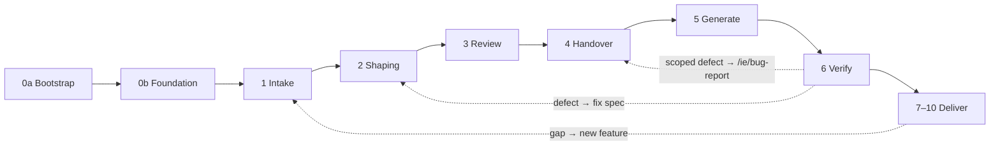
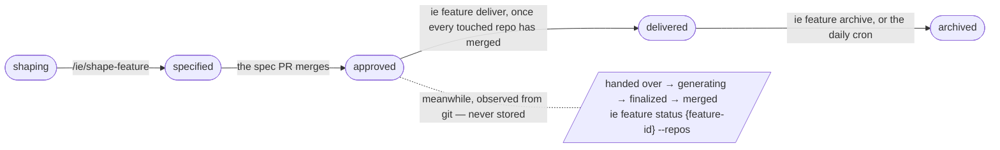
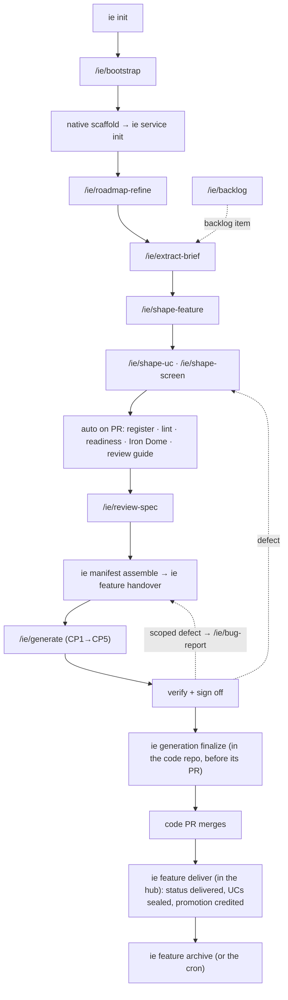

# Intent Engineering SDLC — Product Hub Workflow

> Operator map for this Intent Engineering SDLC product-hub. The always-loaded context is [`../CLAUDE.md`](../CLAUDE.md); this is the browsable reference. Per-command detail lives in [`../.claude/commands/ie/`](../.claude/commands/ie). Kept fresh by `ie update` — edit specs and standards, not this file.
>
> **New here? Walk one feature end-to-end** → [`WALKTHROUGH.md`](WALKTHROUGH.md)
> **New to the vocabulary** (`CP3`, `UC-013`, *waves*, *readiness*)? → [`GLOSSARY.md`](GLOSSARY.md)
> **Seeding the design system** (tokens for UI)? → [`DESIGN-SYSTEM.md`](DESIGN-SYSTEM.md)
> **Found a bug in the feature you're building right now?** → `/ie/bug-report` (run from the code repo, before `ie generation finalize`). Already finalized or merged? → [`WALKTHROUGH.md` → When something's wrong](WALKTHROUGH.md#when-somethings-wrong)

## The flow



## Phase → command

| Phase | Goal | Command(s) |
|-------|------|-----------|
| **0a Bootstrap** | Fill product context, register services | `/ie/bootstrap` |
| **0b Foundation** | Make each service generation-ready | *native scaffold* → `ie service init <id>` |
| **1 Intake** | Epics and backlog items → feature briefs | `/ie/roadmap-refine` · `/ie/backlog` · `/ie/extract-brief` |
| **2 Shaping** | Author specs (Gherkin + OpenAPI + Mermaid + Component YAML) | `/ie/shape-feature` · `/ie/shape-uc` · `/ie/shape-screen` |
| **3 Review** | Spec quality gate + approval | `/ie/review-spec` |
| **4 Handover** | Assemble + distribute the manifest to code repos | `ie manifest assemble` · `ie feature handover` |
| **5 Generate** | 5-checkpoint code generation (run from the code repo) | `/ie/generate` |
| **6 Verify** | Audit AI output, sign off | *checkpoint reviews (auto, in `/ie/generate`)* · human sign-off |
| **7–10 Deliver** | tidy up, merge, then record the delivery in the hub | `ie generation finalize` *(in the code repo, before its PR)* → merge → `ie feature deliver <id>` *(in the hub, after the last merge)* |

Standards authoring/evolution (`/ie/shape-standard`) runs any time, not per-feature. In-flight defect correction (`/ie/bug-report`) loops Verify (6) back into Handover (4) / Generate (5) for the *current* feature, before `ie generation finalize` — a scoped fix, not a new phase; a full re-shape (`P6 → P2` above) is still the right call when the fix is bigger than a targeted correction. `/ie/bug-report` writes the report and its spec corrections on a per-feature bug-report branch (`bug-reports/<feature-id>`), kept off the integration branch until delivery so they are reviewable; land them through your own review PR, and `ie feature deliver` checks they arrived.

Each command writes exactly one side of the hub/code-repo boundary: `handover` writes the code repos, `finalize` writes the repo it runs in, `deliver` and `archive` write the hub. `finalize` runs **in the code repo before its PR** (`--revert` puts it back if review sends the work back); `deliver` is typed **in the hub after the last code PR merges** and refuses until every touched repo carries its finalized archive on the integration branch. The phase between handover and delivery is *observed* from git (`ie feature status <id> --repos`), never stored as a status.

## A feature's five statuses

Five stored statuses, one writer each. Everything between handover and delivery is *observed* from the code repos rather than recorded, so no status can claim work that has not landed.



Reading it:

- **`shaping` → `specified`** — `ie feature create <slug>` opens the folder at `shaping`, then the specs get written. Both statuses ride commits you were making anyway.
- **`specified` → `approved`** — the reviewed spec PR merging *is* the approval; `feature-approve.yml` writes it. Without that workflow, type `ie feature status <id> approved` yourself.
- **`approved` → `delivered`** — nothing is stored while the code is being built. `deliver` checks the evidence first: every touched repo must carry its finalized archive on the integration branch, which is what proves that service both finalized *and* merged. It then seals the owned UCs to `implemented` and credits the promotion pattern in the same write. A UC that another in-flight feature also changes is not sealed: the hub's text for it may already be that feature's, so it stays at its status and is sealed when that feature delivers. Deliver lists each one with the feature it was left for. When two such features deliver at the same time, each leaves the UC for the other; the next delivery of anything then seals it, because nothing in flight changes it any more, and warns that it did. `ie doctor` lists every delivered UC still waiting for its seal.
- **`delivered` → `archived`** — run `ie feature archive <id>` in the hub; refused unless the feature is `delivered`, and the daily cron does it for you once a delivered feature has been quiet for the configured window. The folder (and the feature's bug reports) move to `features/archive/`. Archived features stay readable — `ie feature status`, `ie integrity check` and blast-radius analysis all resolve them — but nothing writes there again.

A defect after `delivered` never reopens the feature: `handover` refuses both end statuses and points at the post-delivery fix rail: `/ie/fix-defect`, run from the hub, which files its own artifact against the delivered feature instead of reopening it.

### The post-delivery fix rail

A defect in delivered work becomes a **`FIX`** — its own id space (`FIX-001`, one
hub-wide sequence), stored at `features/active/post-delivery-defect/FIX-NNN-<slug>/`,
carrying the same manifest shape as a feature. That last part is why the rail is
short: handover, generation, finalize and delivery are the *same commands*, so
there is nothing new to learn after the artifact exists.

```
/ie/fix-defect  →  ie fix create  →  edit the spec  →  spec PR merges (= approved)
                →  ie fix handover  →  /ie/generate  →  ie generation finalize
                →  code PR merges  →  ie fix deliver
```

What the rail does differently from a feature, and why:

- **It skips shaping.** No `shape.md`, no decomposition alternatives, no readiness
  score — a fix has nothing to decompose, and the rubric would score the
  completeness of a spec that already shipped. It starts at `specified`.
- **It debits the trust ladder.** `ie fix create` records a promotion *failure*
  against the pattern the parent was credited for — read from the parent's own
  manifest, never re-derived — with `--logic-defect` when the spec was right and
  the code was wrong. This is the only thing in the framework that demotes a
  pattern. A fix against an `IMP` debits nothing, because a technical change
  exercises no pattern.
- **`ie fix deliver` credits no success.** A correction is not a new delivery of
  the pattern. It still seals the specs (except one other in-flight work also changes) and records the delivery.
- **`--corrects` may name a `FIX`, or a delivered or archived `IMP`.** A defect
  in an already-delivered fix produces another fix; the id names whichever
  delivery last touched the offending spec.
  The pattern is inherited down the chain, so a chain of any length keeps debiting
  the one pattern the feature was originally credited for.
- **A fix gets no bug report.** The `FIX` *is* the defect record. Iteration inside
  one is corrected in place: re-edit, `ie fix handover <id> --refresh`,
  `/ie/generate --resume <N>`.

For a defect in a feature that has **not** been delivered yet, the rail is
`/ie/bug-report` from the code repo instead — it reuses the branch and manifest
that are already there, and records no demotion.

### The improvement rail

A technical change that alters no product behaviour becomes an **`IMP`**. It takes
one of three shapes:

- **substitution** — a technology retired for another: a database engine, a
  datetime representation, a client library, a framework major.
- **optimization** — a named, measured metric that has to move: latency,
  throughput, memory, bundle size, build time.
- **qualitative** — a structural invariant that has to flip: no circular imports,
  a module-size bar, a complexity ceiling, a banned-API count of zero.

The witness principle is one across all three: every `IMP` names one observation
that separates after from before, and verification re-evaluates it — the old thing
gone (substitution), a numeric delta past a bar (optimization), or a check that
fails before and holds after (qualitative). A change that can name none of the
three is not an `IMP`; a refactor that moves no number and flips no check rides
inside a feature or stays uncommitted work.

An `IMP` has its own id space (`IMP-001`, one hub-wide sequence), stored at
`features/active/technical-improvement/IMP-NNN-<slug>/`, carrying the same
manifest shape again.

It exists because every other anchor the hub has is a spec anchor, and a technical
change has none: it names no scope to shape and no defect to correct. Filed as a
feature it would be scored by a rubric measuring a spec nobody is writing; filed as
a fix it would debit a pattern that carries no defect.

```
/ie/improve  →  ie imp create  →  spec PR merges (= approved)
             →  ie imp handover  →  /ie/apply-improvement  →  ie generation finalize
             →  every code PR merges  →  ie imp deliver
```

What the rail does differently:

- **It states an end state, and carries a witness.** `current_state` and
  `target_state` say what the change moves from and to; a reviewer of a migration
  pull request holds the diff against those two strings. An optimization also
  carries a `metric` record (metric, measurement, baseline, better, target) and a
  qualitative change an `invariant` record (property, check) — the machine-checkable
  observation the code side must re-evaluate.
- **It corrects the hub facts at create time.** `product/tech-stack.md`,
  `integrations/index.yml` and technology-naming standards are read by generation
  as constraints, so a stale one keeps emitting code against the retired
  technology for the whole life of the migration. `ie imp create` applies each
  correction and records the text it replaced in `as_was`.
- **It may edit a spec's representation, never its scenarios.** A contract field
  type, a datetime literal inside a step, prose naming the engine, a component
  name in a `component_tree`: these go in `spec_touches`/`screen_touches`, which
  scope Iron Dome and re-register the spec hash, and score, seal and credit
  nothing. `ie imp create` refuses an edit that adds, removes or renames a
  scenario — that is a change to what the product does, and it is a feature.
- **One artifact spans every repo.** `affected_repos` lists them, handover slices
  the manifest per service as usual, and `ie imp deliver` refuses until every one
  of them has merged. A migration that landed in three services out of four is a
  half-migrated system, and this is where that is visible.
- **The code side is its own command.** `/ie/generate` refuses an `IMP` manifest
  by name and points at `/ie/apply-improvement`, because the five generation
  checkpoints derive from a use case, a contract and a screen, and a migration is
  verified by what did *not* change.
- **Verification needs a witness.** The repo's existing gates green, *plus* at
  least one check that would fail against the old technology. A green suite that
  never exercised the changed surface is green for the wrong reason.
- **It skips shaping, scores no readiness, records no risk tier, and touches
  promotion in neither direction.** `ie feature risk` refuses an `IMP` by name.

### Edge cases, and how to resolve them

Each of these is a refusal that names its own remedy at the moment you hit it — this table is so you can recognise the situation before that. **Which repo you stand in** decides half of them: `handover`, `deliver` and `archive` are hub commands; `finalize` and `/ie/bug-report` run in the code repo. Run one in the wrong place and it says so, naming its sibling.

| Situation | What is actually going on | Do this |
|---|---|---|
| You finalized, then review sent the work back | The root manifest is archived, so `/ie/bug-report`, `/ie/generate --resume` and `ie feature handover --refresh` all read that repo as *not in flight* | `ie generation finalize --revert` in that repo. Refused once the finalize commit has merged — that is the next row. |
| A defect turns up after that repo's PR merged, and the feature is not delivered yet | The in-flight loop is over for that repo; the integration branch is not something to revert | `ie feature deliver <id>` in the hub, then the post-delivery fix rail |
| A defect in *this* repo, while sibling services are still generating | Legal by design — the feature is neither `delivered` nor `archived`, so it is not a reopen | `ie feature handover <id>` in the hub — it writes the feature manifest back into the touched repos, which is what puts this one in flight again. Delete the merged feature branch first if you want a fresh base. |
| `deliver`: *no merged archive at `<branch>`* | That service has not finalized, or its PR has not merged | `ie generation finalize` in that repo, merge its PR, re-run |
| `deliver`: *evidence could not be read* | A registered checkout that moved, was renamed or is gone (the registration still looks healthy), or a fetch that failed | Fix the path or the connectivity — `ie doctor` reports both. `--allow-unverified` is the deliberate offline override, and covers *absent* evidence only. |
| `deliver`: *back in flight* | That repo merged its archive earlier, but a live manifest for this feature is there again | Finish that work (`finalize`, merge) or drop it (`finalize --revert`), so no live manifest for the feature remains |
| `deliver`: *work on the feature branch with no counterpart* | Two readings a local probe cannot separate: it never merged, or the repo squash-merges and the branch is simply still around | Merge it if it belongs to this delivery; otherwise delete the leftover branch and re-run |
| `deliver`: *does not exist at `origin/<branch>`* | `--on-branch` checks the feature is on the integration branch **before** it cuts, and it is not there yet | Push the feature's approval state (the merged spec PR) to the integration branch, or drop `--on-branch` and let deliver write the record where you stand |
| `deliver`: *the record could not be read from the branch it cut* | The branch was cut, but the integration branch's `catalog.yml` is missing, unparseable, or has no `use_cases:` | Fix the catalog on the integration branch. Deliver stops rather than writing the record from the branch you were on, which would revert what is there; the message names the branch you are now on and how to get back |
| `deliver`: *touches no code repo* | Both change lists are empty, or the changed specs sit in a domain no service owns | Link the specs (`ie feature add-spec`) or fix domain ownership (`ie doctor` names an unowned domain) |
| `deliver`: *bug-report branch has corrections the integration branch lacks* | A `/ie/bug-report` fix is still sitting on `bug-reports/<feature-id>` and never reached the integration branch (the check is content-based, so a squash-merge counts as landed) | Land the corrections through your review PR, then re-run. `--allow-unmerged-bug-report` is the deliberate override for when they are being landed another way. Deliver never merges or deletes the branch itself — that stays yours (or the forge's) |
| `ie feature handover --bug-report` refuses: *commits newer than the hub commit this feature was handed over from* | The bug-report branch carries integration-branch commits that change specs or screens in this repo's manifest and that the feature was not handed over with: the integration branch was merged into it, or it was cut from the integration branch by an older `ie`. The manifest would take in other features' spec changes | Rebuild the bug-report branch from the commit the error names with only this feature's spec corrections (force-push it if it was pushed), then re-run. `--allow-newer-integration-commits` is the deliberate override for when those changes belong in this feature. A plain `--refresh` is not held this way: it reads every spec from the branch you run it on, so run it only from a branch that brings in no spec changes since the handover other than this feature's own. Run from the integration branch, it takes in every change made there since the handover |
| `ie feature handover --bug-report` refuses: *the hub's HEAD does not contain `<commit>`* | The repo was handed over from a hub commit your checkout does not have, so the manifest and hub copy would be rebuilt from older hub content, even when nothing else would change: you are on a branch cut before that handover, or detached at an older commit | Re-run from a checkout that contains it, such as the feature's bug-report branch. If that branch's corrections reached the integration branch through a squash merge, or the feature's repos were handed over from different hub commits, so the commit is on no branch you would run from, check nothing would be undone and pass `--allow-newer-integration-commits` |
| `ie feature handover --bug-report` refuses: *could not count the hub's commits* | git could not list the commits for this repo's spec and screen paths. On Windows this happens when the manifest names about a thousand paths, more than one command line can carry | Check by hand, with `git log <commit>..HEAD -- specs/` in the hub, that nothing another feature changed is in the manifest's specs, then pass `--allow-newer-integration-commits` |
| `deliver`: *not sealed, left for `<feature-id>`* | Another in-flight feature also changes that UC, so its text on the integration branch may not be what this feature built | Nothing to do. That feature's delivery seals it. If both deliver at the same time, the next delivery seals it and warns: *Also sealed `<UC>` to implemented* |
| `handover` refuses: uncommitted changes in spec paths | Usually the delivery record a bare `deliver` left in your tree | Commit it. An unnoticed delivery record blocks the next feature that touches any of those specs. |
| The delivery PR was rejected and you need to redo it | `delivery/{feature-id}` still exists, and the integration branch has moved on since it was cut | Delete it (`git branch -D delivery/{feature-id}`, plus `git push origin --delete` if it was published) and re-run `ie feature deliver <id> --on-branch`. Deliver refuses to reuse a branch that no longer contains the integration branch — writing the record from a stale one would revert whatever landed while the PR sat in review — and credits nothing twice |
| Every repo merged, but the status is still `approved` | Nothing promotes a feature on CI — that is deliberate | `ie feature deliver <id>`. `ie doctor` flags the feature as ready to deliver. |
| `ie doctor`: *recorded as delivered, but `<service>` carries no merged archive* | A revert or a force-push dropped the evidence after the record was written | Confirm the merge really happened; `ie feature status <id> --repos` shows each repo |
| A defect in an already-`archived` feature | The archive is read-only — status writes, `add-spec`, `add-screen` and `risk --record` all refuse | The post-delivery fix rail. Reading is fine: `ie feature status` and `ie integrity check` both resolve archived features. |

Two that look like failures and are not: a second `finalize` in the same repo reports *already finalized* and changes nothing, and a second `deliver` reports *already delivered* — neither double-seals a spec nor double-credits the promotion pattern. Re-running either is safe.

## Which command do I need?

- Just ran `ie init`? → **`/ie/bootstrap`**
- Mapping and estimating a whole project before any feature exists? → **`/ie/roadmap-refine --map`**, **`/ie/flow <flow-id> --target`**, **`/ie/epic-brief E-NN`**, then **`ie estimate`**. See **Estimate a project**, below.
- Planning at epic level? → **`/ie/roadmap-refine`** · a single feature? → **`/ie/extract-brief`** then **`/ie/shape-feature`**
- Which briefs exist, by domain or epic? → **`ie brief list --group-by domain`** (or `--group-by epic`). It prints each brief's frontmatter, never the brief itself.
- Briefs still waiting for sign-off? → **`ie brief list --branches`**. It adds the briefs that exist only on a `brief/<slug>` branch.
- An idea or a chore that came up between sessions, before anyone writes a brief? → **`/ie/backlog`** — see **The backlog**, below. What is in the backlog, and which items a brief already took? → **`ie backlog list --branches`**
- Describing a process across use cases, or applying a delivered brief's flow change? → **`/ie/flow <flow-id>`** (add `--from-brief <slug>` after delivery, or `--target` to draw a process as it will be under `product/epics/flows/`) — see **Product flows**, below
- Authoring one spec? → **`/ie/shape-uc`** · one screen? → **`/ie/shape-screen`**
  - Note: `/ie/shape-feature` already authors a feature's screens for you (it delegates to the screen-authoring skill per `screen_change`). Reach for `/ie/shape-uc` or `/ie/shape-screen` only for a one-off spec or screen *outside* a feature pass.
- Reviewing a spec before approval? → **`/ie/review-spec`**
- Generating code? → **`/ie/generate`** (from the code repo, after handover)
- Every service of a cross-app feature generated and the stack up? → **`/ie/journey <id>`** (from the hub's **journey repo**, if it has one) — see **Optional: write a cross-app journey**, below
- Found a defect in the feature you're currently building, before finalize? → **`/ie/bug-report`** (from the code repo)
- Found a defect in something already **delivered**? → **`/ie/fix-defect`** (from the **hub**) — it classifies the defect, files a `FIX` against the delivery that introduced it, and debits the trust ladder
- Making a **technical change** and no behaviour with it — retiring a technology (an engine, a datetime representation, a client library), moving a measured metric (latency, memory, bundle size), or flipping a structural invariant (no circular imports, a complexity ceiling)? → **`/ie/improve`** (from the **hub**) — it classifies the change and its shape, corrects any hub facts it falsifies, and files one `IMP` across every repo it reaches

And the lifecycle commands, which is the half people get wrong — the answer is always *which repo do I stand in*:

- Spec PR merged, ready to build? → **`ie feature handover <id>`** (in the **hub**; cuts the feature branch and writes the manifest into each touched repo)
- Generation done and signed off, PR not open yet? → **`ie generation finalize`** (in that **code repo**, on its feature branch; `--revert` if review sends it back)
- Last code PR merged? → **`ie feature deliver <id>`** (in the **hub**; writes `delivered`, seals the UCs no other in-flight feature still changes, credits the pattern, copies each repo's generation metrics into the feature's `metrics.yml`, and marks the feature's tables `delivered` in `product/erd.mermaid` when the hub has one)
- Delivered and quiet? → **`ie feature archive <id>`** (in the **hub**; `delivered` only — the daily cron does it for you after the configured window)
- Not sure where a feature stands? → **`ie feature status <id> --repos`** (in the **hub**; reports each repo's observed state) · **`ie doctor`** cross-checks the stored status against what the repos actually carry
- How did features get through? → **`ie metrics render`** (in the **hub**; one offline HTML page of every feature's metrics trail, with an overview of the most recent work, a searchable picker for any feature, and a dashboard of charts — see below)

## The metrics trail

Every feature, fix and improvement carries `metrics.yml` beside its manifest: a record of how it got through the pipeline. Each fact is written by the command that observes it, so there is nothing to fill in by hand — and nothing should be edited by hand.

- **Stage history.** Every status change appends the status, the time and the version of the `ie` CLI that made it, up to delivery. Failed checks and recorded reviews carry that version too, so the page shows which CLI shaped, specified and reviewed the feature. The trail ends there: archiving, and any check or review after delivery, records nothing.
- **Failed checks.** The feature-level gates `ie integrity check <id>`, `ie feature risk <id>`, `ie spec validate --feature <id>` and `ie spec readiness --feature <id>` each add one entry per failed run: when it ran, the CLI version, and what failed. Integrity findings are the stable finding ids `ie integrity check` prints; a risk run also records the computed and the recorded tier. The page adds up the runs into a failed-run count and the distinct findings, and opens each count into the runs behind it.
- **AI model.** The agent workflows pass `--model` with the model they run on, so a stage change, a failed check or a review made by an agent carries that model. It is reported by the agent, not detected. A command run by hand without `--model` records no model, and the page says so.
- **Review verdicts.** `/ie/review-spec` and `/ie/generate` record each verdict, and `/ie/apply-improvement` each verification. Every verdict that sends the work back (`revise` or `reject`) is one round of rework, whether or not a second review follows the fix.
- **Generation.** At delivery, each repo's blocked and failed counts, checkpoint attempts, model, CLI version and model tokens are copied in.
- **Model tokens.** Each agent workflow runs `ie usage record` at its start, before each of its engineer gates, and when it closes. The CLI reads the Claude Code session's live token counters at each of those points, subagents included, and, when the workflow closes, adds one record to the item: the workflow, the kind of item, per step and per model the input, output, cache-read and cache-creation tokens, and the Claude Code version. A step ends at the gate it names, or at close, and the workflow's total is the sum of its steps. `/ie/roadmap-refine` and `/ie/extract-brief` belong to no item, so their records go to `usage.yml` at the hub root; a brief record lists the briefs its run wrote, several for a batch. A step that could not be measured in full, because its start was missed, the session changed during the workflow (as after `/clear`) and the earlier one could not be read, another workflow in this repo ran in the same session at the same time or its counters could not be read, says `unavailable`, never partial sums. A session closed between gates and resumed later is still measured, from zero in the new process; only what it spent after its last gate is lost. Starting a workflow again discards its open run and says so, which is why a `--resume`, or a bug report resumed by its `BR-n` id, records a resume instead of a new start: the run continues, and what the session did before the resume is not counted. A workflow abandoned before it closes records nothing. No session id, person, prompt, time or cost is stored. Copilot keeps no such record, so its sessions are not counted. Readings in progress are kept in `.ie/usage.yml`, which git ignores.

  > **Warning:** that check only sees workflows in the same repo. If a workflow is still open in the product-hub when the same Claude Code session runs one in a code repo, the hub workflow's record also counts the code repo's tokens, and nothing marks it. Close the hub workflow before you take the session to a code repo. `.ie/usage.yml` also has no lock: two sessions recording in the same working tree at the same instant can lose a workflow's record or count a step twice. Sessions side by side in one working tree each keep their own workflow.

  **Switch the counters on once per machine** with `ie usage counters on`, then open a new terminal and restart Claude Code; without them nothing is recorded. It adds four variables to your Claude Code user settings, one of which keeps the counters on `127.0.0.1`, and a `claude` wrapper to your shell profiles (zsh or bash, and PowerShell), which starts each session on its own port from 9464 so sessions open side by side are each measured. PowerShell gets the wrapper only when its execution policy runs profile scripts, and `on` says how to allow them when it does not. A project cannot switch them on: Claude Code ignores these variables in project settings. While a session runs, its counters are served on `127.0.0.1` without authentication, and any process on your machine can read them; they carry your email and account ids. ie reads only the token counts, and nothing leaves your machine. A session started outside a wrapped shell, from an IDE extension say, is measured only while no other session holds port 9464. `ie usage counters off` removes all of it.

### When the trail is written

- **Counted:** a failed run of one of those gates on your own working copy, which is where `/ie/shape-feature`, `/ie/fix-defect` and `/ie/improve` run them. It changes `metrics.yml`: **commit it with your spec work**, like any other file in the feature folder.
- **Recorded:** a `/ie/review-spec` verdict, an approve included. It changes `metrics.yml` the same way, so commit it with the review.
- **Added when a workflow closes:** its model tokens. It changes `metrics.yml`, or `usage.yml` for roadmap and brief work, without committing it; the workflow commits it right after.
- **Left alone:** a `metrics.yml` the CLI cannot read, or one that names another feature, is never repaired. The command does its own job, prints a warning, and records nothing until the merge conflict in it is resolved or it is restored from git. The page shows such a trail as unreadable, with the reason.
- **Never counted:**
  - a passing run, which writes nothing;
  - any run in CI (wherever the `CI` environment variable is set): Iron Dome and the PR checks run the same gates, and their checkout is never committed back;
  - a single-spec run, `ie spec validate --path` or `ie spec readiness -u`/`--path`, which is what `/ie/shape-uc` and `/ie/bug-report` use while a spec is still being written;
  - a bug report's blast-radius run, `ie integrity check <id> --for <label>`;
  - anything after delivery: the trail ends at `delivered`.
- **Status changes** are recorded wherever the status changes, CI included: the approval workflow commits the `approved` stage it writes.
- **A gate run on the integration branch**, such as a manual `ie integrity check` before delivery, leaves `metrics.yml` modified with no commit to carry it. Commit it with your next hub change, or restore it to drop those runs. `ie feature deliver --on-branch` refuses while it is modified.

Read it with `ie metrics render`. Three things hold everywhere the trail is shown:

- **Stage time is calendar time, including waiting.** It is not effort, and not an input to estimates or planning. It is always shown beside the quality counts for the same feature.
- **It names no person.** Nothing in the file or the page records who did the work, and the trail is not a measure of anyone's productivity.
- **`unavailable` means not observed** — never zero. A feature created before the trail existed is recorded only from its first status change after that, so its totals show `unavailable`, and so does a repo's generation that started before it.

Escapes (fixes that correct a feature) and bug reports are counted when the page is built, from the fixes and bug reports themselves.

Each card shows the model tokens of every workflow run on the item, per step and per model, cache tokens included. The dashboard charts the average input and output tokens per workflow run, overall and by AI model, and lists each roadmap and brief run from `usage.yml` with an input and an output bar. A chart's input is the whole prompt: uncached input, cache read and cache creation together, which the card shows apart. The page never adds output to input and never shows a price.

## Estimate a project

Use this path to estimate a whole project before any feature exists. A business analyst (BA) maps it at epic level, and the architects estimate it. The hub stays a normal product hub. The same hub continues into feature briefing, shaping and generation.

1. **Fill the product context.** Run `ie init <name>`, then `/ie/bootstrap`. The BA writes the mission, the glossary, the themes and the application landscape.
2. **List every epic.** Run `/ie/roadmap-refine --map`. It writes each epic with an `E-NN` id and `priority: "later"`. It sets no limit on the count of epics and sketches no features.
3. **Draw the target processes.** Run `/ie/flow <flow-id> --target` for each process. It writes `product/epics/flows/<flow-id>.bpmn`. Each step names its epics in `ie:epic`, a space-separated list.
4. **Write one epic brief per epic.** Run `/ie/epic-brief E-NN`. It writes `product/epics/E-NN-<slug>.md` and registers each new integration in `integrations/index.yml`. It ends with the ready-to-estimate check.
5. **Record the estimates.** An architect fills the `estimate` block of each ready brief: `size`, `confidence` and `drivers`. The architect writes it by hand or dictates it to the agent. The agent never proposes a size.
6. **Print the roll-up.** Run `ie estimate`. It prints each epic with its status and size, and the project total as a range of person-days. It writes nothing.
7. **Start delivery planning.** Run a normal `/ie/roadmap-refine` to pick the `now` epics and sketch their features. `/ie/extract-brief` then briefs features from the epic briefs and the target flows.

What to know about the files:

- **Target flows** describe the process as it will be. `product/flows/` keeps describing what the delivered application does, and changes only at delivery. Nothing deletes a target flow on delivery. Delete it yourself when it no longer helps.
- **An epic brief** holds thirteen sections in a fixed order. They are Outcome, Scope, Actors and screens, Requirements, Processes, Integrations, Data and migration, Non-functionals and constraints, Dependencies, Difficulties and risks, Unknowns, Assumptions and Estimate. Each requirement is one line, `- R<n> <text>`. A section with nothing to say holds `None.` The BA leaves the Estimate section empty.
- **The estimate block** sits in the brief frontmatter. `size` is `XS`, `S`, `M`, `L` or `XL`. `confidence` is `low`, `medium` or `high`. `drivers` names what drives the cost. Only architects write it. Git history records who estimated and when.
- **The size table** is the `estimation.sizes` block in `config.yml`. It holds a `[min, max]` range of person-days per size. `ie init` writes it with no values. `ie update` never changes `config.yml`, so add the block by hand in an older hub. Without values, `ie estimate` prints sizes and counts and says the table is empty.
- **Status** is derived, never stored. `draft` fails the ready check. `ready` passes it and has no estimate. `estimated` has an estimate and no change since. `stale` has an estimate, and the brief changed or now fails the ready check. A change is anything outside the `estimate` block changed after the last commit that changed that block, uncommitted changes included.
- **The total** counts estimated and stale epics. It always shows a min-max range. `ie estimate` names each stale, XL and low-confidence epic. It also names each roadmap epic with no brief, and each integration with unknown maturity. An XL epic is a signal to split it before a final estimate.
- **The total skips a misnamed brief.** That is a brief whose frontmatter `epic` differs from the id in its file name. `ie estimate` names each misnamed brief and each brief with an invalid estimate.
- **Keep one brief per epic.** When two files carry one epic id, the tools read the first in sorted order. `ie doctor` reports each other file.
- **`ie doctor`** warns about each epic brief that fails the ready check. It never changes the exit code.
- **An integration** that the BA registers in a `draft` registry carries `kind` and `maturity`. It needs no `impl` yet. In a `curated` registry, `/ie/epic-brief` does not write the registry. It reports the gap, and the ready check fails until the registry holds the id.
- **An offer** that quotes the total keeps the `ie estimate --json` output with it. The hub stores no estimate baseline.

## Briefs are signed off by merging their own branch

`/ie/extract-brief` runs `ie brief start <slug>`, which cuts `brief/<slug>` from the integration branch (or switches to it when it exists) and writes the brief there. Open a pull request from that branch: its approval and merge is the sign-off, so the integration branch only ever holds agreed briefs. `/ie/shape-feature` and `ie feature create` refuse a brief that is still only on its `brief/<slug>` branch. Reviewers send a brief back by requesting changes on that pull request, and the engineer answers on the `brief/<slug>` branch. The brief itself records no review state: the merge is the sign-off.

## The backlog

A hub may keep a backlog of ideas and chores that briefs are drawn from: one file per item, `backlog/BL-NNN.yml`, with an `id`, a `title`, a `type` (`idea` or `chore`), who raised it (`raised_by`, their git host login), `why` it matters, and optionally a roadmap `epic` and `links`. It is optional. The hub opts in by holding one item. A hub with no item sees no backlog read, question or suggestion.

- `/ie/backlog` asks for the fields and runs `ie backlog add`, which reserves the `BL` number on origin with a `bl/NNNN` tag, so two engineers adding items at the same time never claim one number. A number is never reused, even after its item is deleted.
- `ie backlog add` commits the item on the checked-out `backlog/*` branch when every commit on it is your own, and otherwise cuts `backlog/BL-NNN` from the integration branch. Several items in one sitting share one branch and one pull request. An item reaches the backlog when that pull request merges.
- `/ie/extract-brief BL-NNN` starts a brief from that item. Given free text, it checks the text against each item's title and `why` and asks whether to start from a match. Given nothing, it suggests an item first and falls back to the roadmap.
- When the brief is committed, `ie backlog remove BL-NNN` deletes the item on `brief/<slug>`, so the item leaves the backlog in the same merge that signs the brief off, and stays when the brief is sent back or abandoned.
- `ie backlog list --branches` marks an item deleted on an open `brief/*` branch, local or on origin, as taken by that branch, and `/ie/extract-brief` never offers it. A brief branch that is not pushed yet is visible only in your own checkout. To release the item of an abandoned brief, delete its branch: `git branch -D brief/<slug>` and `git push origin --delete brief/<slug>`.

The backlog has one tier and no order.

## The data model and each feature's database diagram

Every feature shaped in this hub carries `specification/db-diagram.mermaid`: the database its services' migrations describe today, with the tables and columns the feature adds, changes or drops marked and coloured (green new, amber changed, red dropped). `/ie/shape-feature` has the `dba` worker draw it at Step 6, so the spec PR reviewer sees the schema change before any migration is generated. The hub's pre-push hook (`ie hook pre-push`) refuses a push that changes a feature in `shaping` or `specified` whose diagram is missing, names another feature, or does not parse. A feature already in `shaping` or `specified` before this check existed needs its diagram drawn the next time it is pushed: re-run the Step 6 diagram step for it.

The hub may also carry `product/erd.mermaid`, the whole data model with a status per table: `delivered`, `built`, `planned` or `external`. It is optional, and each change to it has one writer:

- `ie erd init` draws the first one. It reads the SQL migrations of every service linked in `.ie/workspace.yml`, draws those tables as `delivered`, and draws each `domain-model.yml` entity with no table as `planned`. It refuses when the file exists, and it refuses a service whose migrations are in another format, or whose schema comes from JPA or TypeORM entity classes with no migration files, naming the format; draw the file by hand for such a hub. `/ie/bootstrap` offers to run it, and you can run it at any time.
- `ie erd mark-built <id>`, run by `/ie/shape-feature`, adds each table the feature creates as `built` and marks each table it changes `built`. A table the feature drops keeps its class until delivery.
- `ie feature deliver <id>` marks the feature's added and changed tables `delivered`, and removes its dropped tables and columns.

Nothing checks the data model against the code, so a hand edit can make it disagree with the database. `ie doctor` warns about a table with no status class or with a class that is not one of the four.

## Product flows

A hub may describe what the application does end to end as flows: BPMN 2.0 files under `product/flows/`, one process each, with each step tagged with its epic, domains and use cases. It is optional. The hub opts in by holding one flow, which `/ie/bootstrap` offers to write and `/ie/flow <flow-id>` adds at any time. A hub with no flow sees no flow question, no flow read and no flow warning.

In a hub that holds flows:

- `/ie/roadmap-refine` and `/ie/extract-brief` read the flows before they propose epics or briefs.
- A brief that changes a process lists the flows in its `flows` frontmatter and names the changed steps in its body. `/ie/extract-brief` offers to draft the change as `features/briefs/<slug>/flows/<flow-id>.bpmn`, so the reviewer sees it as a diagram in the brief's pull request.
- A flow describes the application as it is today, so it changes only at delivery. After `ie feature deliver`, run `/ie/flow <flow-id> --from-brief <slug>`. It applies the brief's changes to the current flow, keeps the changes another delivery made, and deletes the draft. `ie feature deliver` warns when the brief lists a flow that has not changed since the brief was signed off, and prints that command.
- `ie fix deliver` warns once for each flow with a step whose `ie:useCases` names a use case the fix changes, and prints `/ie/flow <flow-id>`. A step with no `ie:useCases` gets no warning.
- `ie doctor` warns about a flow or draft that does not parse, a step that names an unknown epic, context or use case, and a brief `flows` entry that names no flow and no draft.

None of these warnings changes an exit code. Only `/ie/bootstrap` and `/ie/flow` write under `product/flows/`. Agents write only the process; `ie flow layout <file>` writes the diagram coordinates, and the layout gives lanes and participants none.

## Working on more than one feature at a time

Two people shaping at once used to be able to give two different features the same `FT` number. Nothing noticed, the duplicate merged, and from then on every command that resolved that number answered about whichever feature folder the filesystem happened to list first. Three things changed, and they are worth knowing because two of them change what you see:

- **One branch per feature, fix or improvement, cut for you.** `ie feature create` (which `/ie/shape-feature` runs for you at Step 1) cuts `feature/FT-NNN-{slug}` from the integration branch and switches you onto it, `ie fix create` (which `/ie/fix-defect` runs at its Step 5) does the same with `fix/FIX-NNN-{slug}`, and `ie imp create` (which `/ie/improve` runs at its Step 6) with `imp/IMP-NNN-{slug}`. None of the three has an opt-out, because the spec PR is how the work reaches `approved` and a PR needs a branch to come from. Both halves of a feature branch name are configurable — `feature_branch_prefix` for the branch half, `naming.feature_prefix` for the id half. So shaping happens on a feature branch, and the spec PR that approves the feature comes from a branch the framework named. `ie feature create` refuses uncommitted brief edits under `features/briefs/`: a brief reaches the integration branch through its own pull request. Mockup feedback folded back from a sandbox-hub is the exception and comes along. It tells you what base it actually used, too: if `origin` could not be reached it cuts from the copy of the integration branch you already had and says it may be behind, and if the branch already existed it switches to it rather than cutting, and tells you how to check where that branch came from.
- **Numbers are claimed on `origin`, not guessed locally.** The next free number is worked out from your files *and* every branch on `origin`, and for a feature, a post-delivery fix, a technical improvement or a backlog item it is then locked by pushing a small `ft/NNNN`, `fix/NNNN`, `imp/NNNN` or `bl/NNNN` tag: `origin` rejects a tag that already exists, so two people cannot both win. To see what is claimed but not merged yet: `git ls-remote --tags origin "ft/*" "fix/*" "imp/*" "bl/*"`. Those tag names stay literal even if you rename `naming.feature_prefix`, because they name a *number series*, not a spelling. Those four are tagged because a number can sit on an unpushed branch while someone else claims the next one, and is quoted after its artifact is gone. Use cases, screens and standards are not. They are claimed several times in one sitting and authored promptly, and a tag apiece would turn `origin` into a tag dump, so for those ask `ie id next use-case | screen | standard` and author the artifact promptly rather than sitting on the number.
- **A duplicate now goes red.** `ie doctor` and `ie integrity check` both fail on two artifacts sharing an id — features, fixes, technical improvements, backlog items, use cases, screens and standards — so it is caught before merge instead of surviving in the hub. There is deliberately no way to switch this off — a duplicated id has no acceptable form, because every command that resolves it answers about whichever artifact the filesystem lists first. Fixing one is a hand renumbering: **Renumbering a duplicated id**, below.

**Sequencing hint, not a rule:** where you can, finish shaping one feature before starting the next. Concurrent features are supported and expected, but every parallel branch also rewrites shared files (`catalog.yml`, `promotion.yml`, `domain-model.yml`), and those merges are yours to resolve. Nothing stops you; it is simply cheaper in order.

### Renumbering a duplicated id

There is no `ie renumber` command, and that is on purpose: renumbering rewrites the artifact's name, its `id` field, its registry entry, every reference to it, and therefore its hash — so it is done by hand and then checked. Renumber the **newer** artifact (the one fewer things point at), on its own branch.

1. **Pick the new number** — `ie id next use-case`, or `screen` / `standard` / `feature` / `fix` / `improvement` / `backlog`. Do this first: it looks at `origin` as well as your files, so it will not hand you a number someone else is already holding. Ask for the kind you are renumbering: the series never cross, so a number taken from the wrong one is a number the duplicate check will not clear.
2. **Rename the artifact** — a folder for a use case (`specs/{domain}/UC-007-…`), a feature (`features/active/FT-012-…`) a post-delivery fix or a technical improvement, which each sit one level deeper (`features/active/post-delivery-defect/FIX-003-…`, `features/active/technical-improvement/IMP-004-…`); a single file for a screen (`screens/{app}/{domain}/SCR-004-….yml`) a standard (`standards/{category}/STD-021-….md`) or a backlog item (`backlog/BL-012.yml`).
3. **Change the id inside it** — `meta.yml` for a use case, `manifest.yml` for a feature, a fix or a technical improvement, the `id:` field for a screen, the heading and front matter for a standard, the `id:` field for a backlog item.
4. **Update the registry** — `catalog.yml` (both `id` and `path`) for a use case, `standards/index.yml` for a standard. Features, fixes, improvements, screens and backlog items have no registry entry.
5. **Update every reference** — `git grep -n "UC-007"` from the hub root (`git grep` works the same in bash, PowerShell and cmd), then fix what it finds: another spec's `dependencies.calls`, a screen's `use_case_ref` or `props.optionsFrom`, a feature manifest's `spec_changes` / `screen_changes`, `shape.md`, `plan.md`, the roadmap.
6. **Re-hash — this step is different for each kind, and only one of them is `ie doctor --fix`.** For a **use case**, `ie doctor --fix` recomputes the spec hash and writes it back to both `meta.yml` and `catalog.yml`; skipping it leaves the hub reporting drift instead of a duplicate. A **standard** and a **backlog item** carry no hash, so there is nothing to do. A **screen**, a **feature**, a **fix** and a **technical improvement** have no hash of their own, but a service that already received a handover holds a manifest naming the old id (and, for a screen, the hash of the file you just renamed), so re-run `ie feature handover` — or `ie fix handover` / `ie imp handover` for those kinds — for the affected services. `ie doctor --fix` only ever touches use cases, so running it after renumbering the others reports no drift and changes nothing — that is expected, not a sign the rename worked.
   **A technical improvement needs a different repair again.** It credits and debits nothing, so `promotion.yml` needs no edit — the spec hashes are the exposure instead. `ie imp create` re-registered a hash for every spec under `spec_touches`, and two improvements sharing an id mean one of those registrations was recorded against the wrong artifact: re-run `ie spec register` for every spec listed under `spec_touches`, and `ie imp handover` for its services if handover already ran.
   **A fix needs one repair a feature does not.** Two fixes sharing an id debited the trust ladder once, not twice: the promotion log records one entry per artifact id, so the second defect was silently free. Open `promotion.yml`, find the `outcome: failure` event naming the id you just renumbered, and add the matching one for the renamed fix — otherwise the pattern keeps credit it has not earned. This is on top of the re-handover above, not instead of it: `ie doctor` and `ie integrity check` print both steps for a fix.
7. **Confirm** — `ie doctor` (its **Identifiers** section must read *Every id is used once*), plus `ie integrity check <feature-id>` (or the fix or improvement id) if any is mid-flight.

**If you renumbered a feature, fix or improvement whose branch was already cut,** rename the branch too:

```bash
git branch -m feature/FT-012-{slug} feature/FT-013-{slug}   # a feature
git branch -m fix/FIX-003-{slug}    fix/FIX-004-{slug}      # a fix
git branch -m imp/IMP-004-{slug}    imp/IMP-005-{slug}      # a technical improvement
```

Leave the old reservation tag on `origin` where it is — `ft/0012`, `fix/0003` or `imp/0004` — because reservation tags are never deleted: a freed number would then be handed out twice. Note that `fix/` and `imp/` each mean two different things here, and only one of them is yours to rename: `fix/FIX-003-{slug}` and `imp/IMP-004-{slug}` are the **branches** (from `config.yml` `fix_branch_prefix` and `imp_branch_prefix`), while `fix/0003` and `imp/0004` are the **reservation tags**. For features the two never look alike, because the branch prefix is `feature/` and the tag namespace is `ft/`.

**If code was already generated against the old id,** renumber in the hub first, then re-run `ie feature handover` (or `ie fix handover` / `ie imp handover`) for the affected services so the manifest they read matches.

## Optional: mock the feature up before shaping it

Between `/ie/extract-brief` and `/ie/shape-feature` there is an optional loop worth knowing about: turn the brief you just wrote into **throwaway screens built from this product's real components**, look at them, and feed what that review surfaced back into shaping. Reach for it when a feature is easier to judge on screen than on paper — new UI, a contested flow, anything you'd otherwise specify twice.

**It happens in a different repo you move to** — a **sandbox-hub** (`ie sandbox-hub init <name>`), which holds no specs and generates no code. This hub stores nothing about it and never initiates anything: both crossings are started from over there.

1. `/ie/extract-brief` writes `features/briefs/<slug>/{requirements.md, decisions.md}` — that pair, unchanged, **is** what the mockup is drafted from. The sandbox reads the brief from this hub's working tree, so leave the hub on `brief/<slug>` until the brief is signed off.
2. In the sandbox-hub: `/ie/create-feature-mockup <slug>` (it fetches the brief and this hub's `design-system/` itself, once the sandbox has been linked with `ie sandbox-hub init . --hub <path-to-this-hub>`), review, iterate.
3. Still there: `/ie/extract-feature-feedback <slug>` writes the review up as **`features/briefs/<slug>/mockup-feedback.md`**, next to the brief, uncommitted. The mockup step also leaves a **`features/briefs/<slug>/draft-screens.md`** beside it: the draft screen spec the mockup produced as a by-product, so what the analyst worked out on screen graduates into shaping instead of being thrown away with the mockup. Review both diffs and commit them with your shaping work. They are the one kind of uncommitted change under `features/briefs/` that `ie feature create` lets through, and they come along onto the feature branch. You can also commit them on `brief/<slug>`, so they reach the reviewers with the brief.
4. `/ie/shape-feature` reads both as advisory input alongside the brief. Nothing is gated on either.

**"Real components" means this hub's `design-system/`, whether or not a vendor library is bound.** The mirrored `inventory.yml` is the vocabulary the mockup composes from, and each entry's realization is how the sandbox obtains that component: a vendor package, an npm package, or — for `impl.kind: custom` — the component's real code, copied out of the front-end app the entry's `impl.module` names. A component the brief needs and `inventory.yml` doesn't declare is one the mockup stops and asks about, and it comes back in the feedback: adding to the vocabulary is a product decision, and it is taken here. See [`DESIGN-SYSTEM.md`](DESIGN-SYSTEM.md).

No feature id is involved: the loop sits *before* `ie feature create`, and the brief slug is the only identity. Those two files are the **only** things a sandbox-hub ever writes here, and they land in `features/briefs/`, which carries no `meta.yml`, no `spec_hash`, no status machine and no gate — so a mockup review cannot touch spec state.

**Expected feedback that never arrived?** This hub cannot fetch it — go to the sandbox-hub and run `/ie/extract-feature-feedback <slug>` there.

## Optional: write a cross-app journey

If this hub registers a **journey repo** (a service with `type: e2e`, adopted with `ie service init`), a feature that crosses applications can get one executable end-to-end journey. **It happens in the journey repo**, not here, and only once every service the feature touches has generated and the stack is up: a journey is only written where it can be run.

1. Bring the stack up the way this hub documents it.
2. In the journey repo: `/ie/journey <id>`. It reads the feature's scenarios from this hub, derives their keys with `ie spec scenarios`, and loads the hub standards that apply to that repo: the general ones, plus `standards/<framework>/` for the framework its service entry declares (`playwright` by default). It writes one journey, runs it twice, and commits it only when both runs are green.
3. A red run is a finding, not a retry: `/ie/bug-report` while the feature is in flight, `/ie/fix-defect` once it is delivered.

The Playwright standards reach this hub only when `config.yml` `standards_categories` lists `playwright`; add it and run `ie standards migrate --apply`. `ie feature handover` never writes to the journey repo, and nothing waits for a journey: a missing one never blocks `ie feature deliver`.

## Greenfield: make a service generation-ready (Phase 0b)

IE does **not** scaffold service code — you use the native tool, then adopt the result. `/ie/bootstrap` emits the full runbook after service registration. Summary:

1. **Scaffold** with the native tool — Spring Boot → [Spring Initializr](https://start.spring.io); Next.js → `pnpm create next-app`; .NET → `dotnet new webapi`.
2. **Create the empty remote** matching `git_remote` in `services/<id>.yml`.
3. **Push** the scaffold.
4. **Adopt:** from the product-hub, `ie service init <id> --path <checkout>` → creates `.flowforge/`, registers in `.ie/workspace.yml`, marks gates.
5. **CI:** give the repo its own build/test workflow and require its checks on the integration branch, then `ie service init <id> --path <checkout> --ci-configured`.

`/ie/generate` hard-blocks until the required gates pass (`repo_exists`, `flowforge_initialized`, `workspace_registered`, `ci_configured`). Check with `ie service status <id>`. Brownfield services skip this — run `ie workspace bootstrap` instead.

`ci_configured` is about the **repo's own** CI. `ie service init` copies IE's `quality-gates.yml` into the repo, but that workflow only checks spec alignment — it runs no build and no tests, so its presence does not meet the gate. The service repo's `docs/WORKFLOW.md` → "Your own build and test CI" is the instruction to hand the engineer.

## Seed the design system (before UI shaping)

If this hub has UI, give it a **design system** — the single source for the colours, type and spacing tokens every screen spec and generated frontend binds to — **before** shaping UI features. There's no auto-importer: you generate a design with Claude, Claude extracts candidate tokens, you review, then `ie design-system init` / `check` / `compile` take over. Full step-by-step: **[`DESIGN-SYSTEM.md`](DESIGN-SYSTEM.md)**. After seeding, `/ie/shape-screen`, Iron Dome and `/ie/generate` all bind to it automatically.

**Binding to a client's existing component platform instead?** If the hub should draw its tokens/components from a vendor's own design system (exposed as an MCP server) rather than hand-author them, bind to it — one `/ie/design-system-vendor-connect`, then `ie design-system vendor status` / `refresh` / `upgrade` for steady state. There is nothing to reconcile: the vendor's catalog lands in a generated `vendor.lock.json`, your decisions stay in `inventory.yml` / `tokens.yml` and are read first. No MCP server yet? Build one over the platform with `ie vendor-mcp init` / `build`. Opt-in and additive — a hub that never touches it keeps working exactly as above. Same doc: **[`DESIGN-SYSTEM.md`](DESIGN-SYSTEM.md)** (vendor section).

## Keeping services current

Run **`ie update`** from the hub to pull the latest scaffold (commands, skills, workflows, config) into this hub after upgrading the CLI. In a terminal it is **guided**: it shows the plan and asks before applying, whether to adopt any files you've locally edited, and whether to also sync your linked code repos — no flags to remember. Pass `--yes` (or run in CI/non-interactive) for the historical flag-driven behavior; `--force` adopts locally-edited files, `--paths <csv>` scopes the run.

Scaffold improvements — the spec-gate `quality-gates.yml`, code-repo `docs/WORKFLOW.md`, `/ie/generate` — reach already-adopted services with **`ie update --code-repos`** (or answer "yes" to the code-repos prompt above). Run from the hub, it syncs the hub *and* fans out to every locally-linked repo, edit-safely: a file an engineer has changed is **held and reported**, not clobbered (`--force` adopts the scaffold version). It edits working trees only — review the diff and commit in each repo. Repos adopted before this feature take a one-time `ie update --code-repos --force`; repos not linked on this machine are skipped (run `ie workspace link <id> <path>` first).

## Command index

| Command | Detail |
|---------|--------|
| `/ie/bootstrap` | [bootstrap.md](../.claude/commands/ie/bootstrap.md) |
| `/ie/roadmap-refine` | [roadmap-refine.md](../.claude/commands/ie/roadmap-refine.md) |
| `/ie/backlog` | [backlog.md](../.claude/commands/ie/backlog.md) |
| `/ie/extract-brief` | [extract-brief.md](../.claude/commands/ie/extract-brief.md) |
| `/ie/epic-brief` | [epic-brief.md](../.claude/commands/ie/epic-brief.md) |
| `/ie/flow` | [flow.md](../.claude/commands/ie/flow.md) |
| `/ie/shape-feature` | [shape-feature.md](../.claude/commands/ie/shape-feature.md) |
| `/ie/shape-uc` | [shape-uc.md](../.claude/commands/ie/shape-uc.md) |
| `/ie/shape-screen` | [shape-screen.md](../.claude/commands/ie/shape-screen.md) |
| `/ie/shape-standard` | [shape-standard.md](../.claude/commands/ie/shape-standard.md) |
| `/ie/review-spec` | [review-spec.md](../.claude/commands/ie/review-spec.md) |
| `/ie/generate` | [generate.md](../.claude/commands/ie/generate.md) |
| `/ie/bug-report` | [bug-report.md](../.claude/commands/ie/bug-report.md) — run from the **code repo**, not the hub |

CLI: `ie <group> --help` (groups: `feature`, `spec`, `service`, `workspace`, `manifest`, `hub`, `bug-report`, `checkpoint`, `promotion`, `audit`, `doctor`, `status`, `update`, `runtime`, `design-system`, `vendor-mcp`, `flow`, `brief`, `backlog`, `estimate`). Every command supports `--json`.

### Invoking commands per runtime

The `/ie/<verb>` column above is the **Claude Code** gesture. The same verbs are available in every enabled runtime under one naming convention — only the gesture differs:

| Runtime | How you invoke `<verb>` |
|---------|-------------------------|
| **Claude Code** | `/ie/<verb>` slash command |
| **GitHub Copilot CLI** | `copilot --agent ie-<verb>` (or pick `ie-<verb>` from the `/agent` menu) |

Enable a runtime with `ie runtime add copilot` (then commit the emitted `.github/agents/` + `AGENTS.md`); see the enabled set and parity with `ie runtime list` / `ie runtime verify`. For CI/automation, the documented one-shot is `copilot --agent ie-<verb> -p "<prompt>"` (or `claude -p`); the `ie` CLI never launches the AI itself.

## Operator command flow


