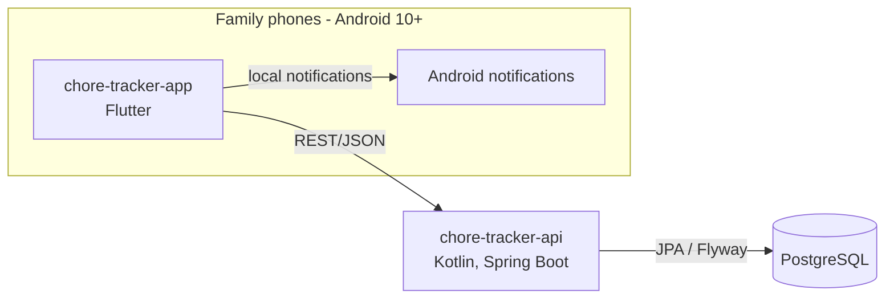

# Application Landscape

## High-Level Architecture

Chore Tracker has two deployable parts that live together in one code repository, `NexiosIT/chore-tracker-code`. This product hub (`NexiosIT/chore-tracker`) holds the specs and is kept separate from the code.

- **chore-tracker-app** is a Flutter app for Android 10 and newer. Parents and kids both use it. It talks to the backend over a REST/JSON API. It schedules local Android notifications itself for chores that are due soon, and it runs a background check against the API (roughly every 15 minutes, as Android allows) to pick up new chores, approvals and completions.
- **chore-tracker-api** is a Kotlin Spring Boot 4.0 service. It owns all business rules: family members and registrations, chores and templates, points, exchange rates and redemptions, and notifications. It stores its data in PostgreSQL through Spring Data JPA, with Flyway migrations.

Streaks and leaderboards are calculated by the API from completed chores and points entries; they are not stored.

## System Boundaries

**Inside this project**
- The Android app and the backend API, including all chore, points, approval and redemption rules.
- The PostgreSQL database and its migrations.
- In-app and local Android notifications.
- The hand-authored design system, based on Material Design 3.

**Outside this project**
- Paying pocket money and giving screen time. These happen in the real world. The app only records a redemption and lets a parent mark it as granted.
- Enforcing screen time on devices. The app does not control any device's screen time.
- Hosting, CI/CD and app distribution. These are not decided yet.
- Other families. The system serves one family only.

## External Integrations

None at this stage.

- **Push notifications:** no external push service is used. "Due soon" reminders are scheduled locally on the phone, and other events reach the phone through the app's background check. Firebase Cloud Messaging can be added later if instant alerts are needed.
- **Payments:** none. No payment details are stored.
- **Design system:** no vendor component or token platform. The hub's `design-system/` is hand-authored and stays close to Material Design 3, the design system Google Calendar uses.
