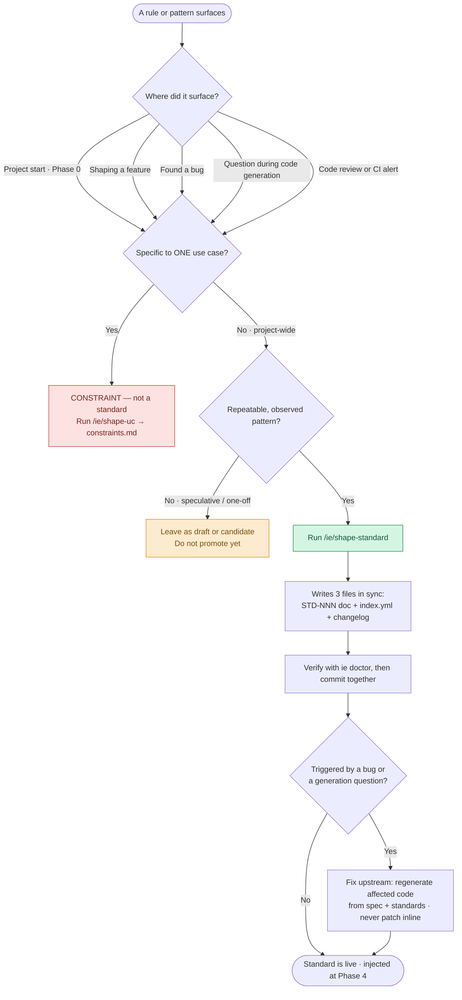

# Standards

How we always build — conventions, patterns, and design system rules that constrain code generation.

## What Goes Here

Standard documents partitioned by **stack-agnostic** vs **stack-coupled** scope, plus a master index and changelog.

## Standards vs. Constraints

A **standard** is a project-wide, repeatable rule — *how we always build*. It lives here and is matched to every spec it applies to.

A **constraint** is a non-functional requirement specific to a *single* use case. It lives in that use case's `constraints.md` (inside the UC spec folder), not here, and is authored as part of `/ie/shape-uc`.

Decide with one question: **does the rule apply to every feature in its scope, or only to one use case?**

| | Standard (here) | Constraint (`constraints.md`) |
|---|---|---|
| Scope | Project-wide, repeatable | One use case |
| Example | "modals always trap focus", "all APIs p95 < 200 ms" | "*this* dashboard loads < 2s", "*this* endpoint needs MFA > $10k" |
| Authored by | `/ie/shape-standard` (standards-authoring skill) | `/ie/shape-uc` (use-case-authoring skill) |

## Structure

```
standards/
├── index.yml          # Master index of all standards with applicability rules
├── changelog.md       # Record of standards additions and changes
│
├── general/           # Stack-agnostic — naming, repo hygiene, commit style
├── api/               # Stack-agnostic — response envelopes, error categories, versioning (contract-level)
├── nfr/               # Stack-agnostic — performance, accessibility, observability budgets
│
├── spring-boot/       # Stack-coupled — Spring @Service / @RestController / JPA / Mockito idioms
├── nextjs/            # Stack-coupled — App Router / React Query / RHF / forwardRef + CVA idioms
└── playwright/        # Stack-coupled — Playwright Test config / fixtures + page objects / locators / storage-state auth
```

The stack-coupled directories are keyed by the `framework` field in `services/*.yml`. The manifest assembler injects a stack-coupled directory only when a touched service declares that framework; `/ie/journey` loads `playwright/` itself, since a journey repo receives no manifest. Add a new directory (e.g. `nestjs/`, `dotnet/`) when a product picks up a new stack — no code change needed.

## Naming Convention

Standard files: `STD-{NNN}-{kebab-name}.md` for promoted standards, `{descriptive-name}.md` for drafts. Place under the directory matching scope.

## How Standards Evolve

Two-layer discovery:
1. **CI-driven detection:** Every merge is analyzed for patterns not matching indexed standards. Unindexed patterns create review alerts.
2. **Periodic human review:** Every 3-5 sprints, the System Guardian reviews detected patterns and promotes worthy ones to official standards.

## Adding or Changing a Standard

A standard lives in **three files that must stay in sync**. Forget the `index.yml` entry and the document is silently never injected into generation — no error, it just never applies.

**Easiest:** run `/ie/shape-standard` (the **standards-authoring** skill). It classifies standard vs constraint, picks the category, assigns the next ID, writes the document, and keeps all three files in sync.

**Manual recipe** (fallback / for reference):

1. **Write the document** at `standards/{category}/STD-{NNN}-{name}.md`. Get the number from `ie id next standard` — never by reading `index.yml` and incrementing, because the index shows only what has merged, so two authors working at the same time would be handed the same number. IDs are global across the whole hub, not per-category. Model it on an existing `STD-*` file: frontmatter (`id, name, version, category, status, last_reviewed`) → one-sentence MUST-rule blockquote → Motivation → Rules → Examples (compliant + non-compliant) → Applicability → References.
2. **Register it in `index.yml`** — add an entry with all required fields. The `path` must match the file you just wrote; `applies_to.service_types` scopes it (`[]` = all); only `status: active` is injected at Phase 4. Validate against `schemas/standards-index.schema.json`.
3. **Log it in `changelog.md`** — one row: `| {date} | added | STD-{NNN} | {name — brief description} |`.

**Verify:** run `ie doctor` to catch stack/standards drift, then commit the three files together.

**Changing / deprecating:** bump `version` (or set `status: deprecated`) in **both** the document frontmatter and the index entry, update `last_reviewed`, and add an `updated`/`deprecated` changelog row. Never delete a deprecated file — keep the audit trail.

### When (and when not) to author a standard

A standard can surface at any moment — Phase 0 seeding, feature shaping, a bug, an unspecified decision during code generation, or a CI/review alert. The moment doesn't decide anything: the test is always the same. Is it specific to one use case (→ a constraint, not a standard)? Is it a repeatable, observed pattern (→ author it) or speculative (→ leave it as a draft)? And anything surfaced downstream is fixed *upstream* and regenerated, never patched inline.



## How Standards Are Used

During Phase 4 (Agent Priming), the manifest assembly service matches applicable standards to the target spec using the `index.yml` applicability rules — by service type, framework, and **domain** (`applies_to.domains`; empty = all). Matched standards are included in the agent manifest as path references.

Two refinements narrow what gets injected:
- **`injection: workflow`** — the standard is enforced procedurally by a workflow template (e.g. the execution-discipline standards in `/ie/generate`), so its body is **not** loaded into context. Default (`context`) standards are injected as usual.
- **`applies_to.domains`** — a non-empty list scopes the standard to specific `specs/{domain}/` domains, so it's injected only for generations touching one of them.
